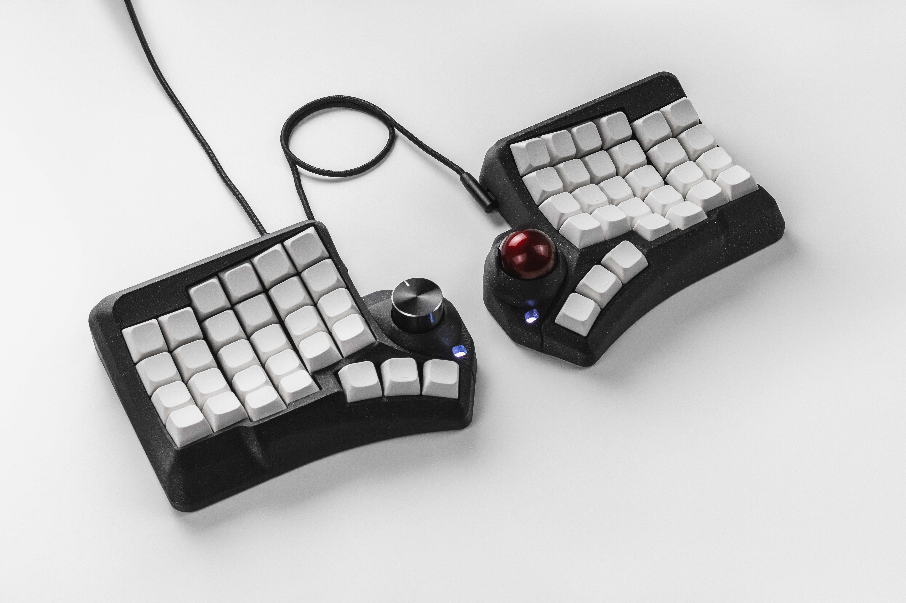
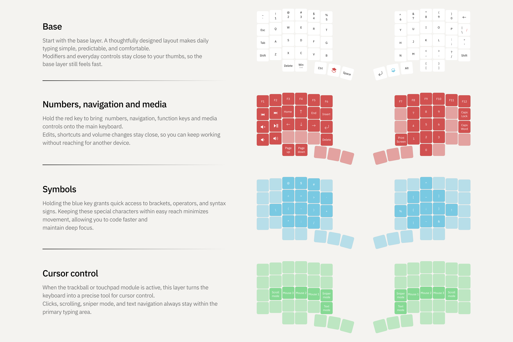
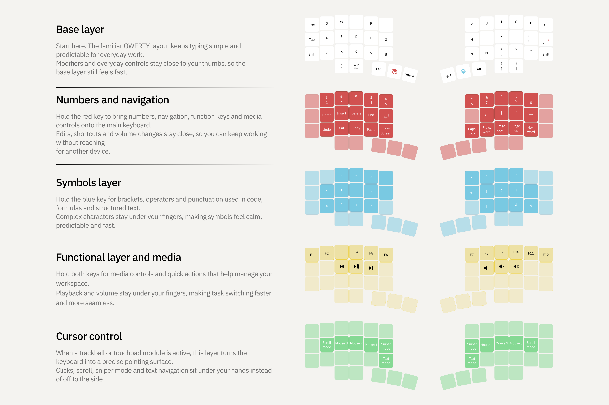
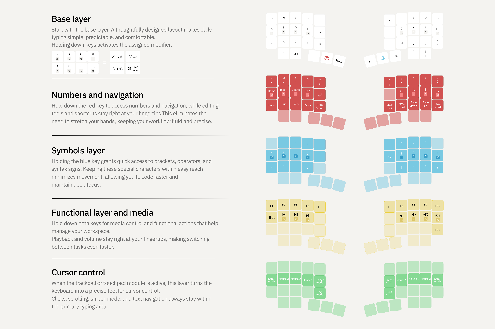

# Phenom — a flagship ergonomic split keyboard for those who value precision, speed, and complete control over their workspace

## Features

- Sculpted ergonomic 3D case with individually positioned rows and columns
- 58 programmable keys and up to 15 additional layers
- Hot-swappable MX switches
- Hot-swappable trackball, touchpad, and encoder modules for either half
- Scroll, Sniper, and Text modes for trackball and touchpad modules
- Key remapping and keyboard configuration through [Entropy](https://entropy.tools/)
- USB Type-C connectivity
- QMK firmware

Phenom Mini

46 programmable keys and up to 15 additional layers

Phenom Micro

40 programmable keys and up to 15 additional layers

## Files

Case models, PCB files, and assembly guides will be added as they become available

- `stl/` — printable case and module models
- `step/` — editable case and module models in STEP format
- `pcb/` — Gerber files, drill files, schematics, and PCB design sources
- `build_guide/` — PCB assembly guides in English, including modules
- `handwired/` — handwired assembly guides in English, without modules, with dedicated `stl/` and `step/` models
- `images/` — keyboard photos and illustrations

## BOM

Switchplate and holder quantities cover both halves. Module and pogo_system board quantities below follow their respective PCB BOMs; additional module parts are listed per module

<strong>Switchplate — both halves</strong>

| Component | Quantity |
| --- | ---: |
| `ZX-SH1.0-12PWT` | 2 pcs |
| Diode `1N4148WT` | 52 pcs |
| Kailh hot-swap socket `CPG151101S11-16` | 58 pcs |
| `ZX-SH1.0-6PWT` | 2 pcs |

[Original BOM (XLSX)](pcb/switchplate/BOM_Phenom_switchplate_v2_2.xlsx)

<strong>Holder — both halves</strong>

| Component | Quantity |
| --- | ---: |
| Capacitor 1uF, 0402 — `CC0402MRX5R6BB105` | 4 pcs |
| Capacitor 15pF, 0402 — `0402CG150J500NT` | 4 pcs |
| Capacitor 100nF, 0402 — `CL05B104KB54PNC` | 10 pcs |
| Capacitor 2.2uF, 0402 — `CL05A225MQ5NSNC` | 2 pcs |
| `ZX-SH1.0-12PWT` | 2 pcs |
| `ZX-SH1.0-6PWT` | 2 pcs |
| `ZX-SH1.0-14PWT` | 2 pcs |
| Diode `1N4148WT` | 10 pcs |
| Microcontroller `RP2040` | 2 pcs |
| Resistor 5.1kΩ, 0402 — `0402WGF5101TCE` | 6 pcs |
| Resistor 1kΩ, 0402 — `0402WGF1001TCE` | 2 pcs |
| Resistor 200Ω, 0402 — `0402WGF2000TCE` | 2 pcs |
| Resistor 27Ω, 0402 — `0402WGF270JTCE` | 4 pcs |
| Push button `GT-TC084E-H065-L5` | 4 pcs |
| LDO, SOT-23-3, 662K | 2 pcs |
| Flash memory `W25Q32JVSSIQ` | 2 pcs |
| USB-C connector `USB-TYPE-C-018` | 4 pcs |
| 12 MHz crystal `XXHCCLNANF-12.000000MHZ` | 2 pcs |

[Original BOM (XLSX)](pcb/holder/BOM_Phenom_holder_wired_v2.xlsx)

<strong>Shared module connection board — pogo_system</strong>

| Component | Quantity |
| --- | ---: |
| `ZX-SH1.0-4PWT` | 1 pc |
| `ZX-SH1.0-9PWT` | 1 pc |
| `ZX-SH1.0-6PWT` | 1 pc |
| `ZX-SH1.0-14PWT` | 1 pc |

[Original BOM (XLSX)](pcb/pogo_system/BOM_Phenom_pogo_system.xlsx)

<strong>Encoder module</strong>

| Component | Quantity |
| --- | ---: |
| `ZX-SH1.0-8PWT` | 1 pc |
| Diode `1N4148WT` | 1 pc |
| Resistor 5.1kΩ, 0402 — `0402WGF5101TCE` | 1 pc |
| Resistor 10kΩ, 0402 — `RC0402FR-0710KL` | 1 pc |
| EC11 encoder | 1 pc |
| Encoder cap | 1 pc |

[Original BOM (XLSX)](pcb/modules/encoder/BOM_Encoder.xlsx)

<strong>Touchpad module</strong>

| Component | Quantity |
| --- | ---: |
| Azoteq TPS43 touchpad | 1 pc |
| PH2.0 connector, 4 pins, 2 mm pitch, 90° | 1 pc |
| PH2.0 cable connector, 4 pins, 2 mm, 6 mm, one head | 1 pc |

Uses the shared pogo_system board: solder the PH2.0 connector to the board and the cable to the Azoteq TPS43

<strong>Trackball module</strong>

| Component | Quantity |
| --- | ---: |
| Capacitor 100nF, 0402 — `CL05B104KB54PNC` | 4 pcs |
| Capacitor 10uF, 0402 — `CL05A106MQ5NUNC` | 2 pcs |
| Capacitor 10nF, 0402 — `TCC0402X7R103M500AT` | 2 pcs |
| Capacitor 3.3uF, 0402 — `C1005X5R0J335MTJ00E` | 1 pc |
| `ZX-SH1.0-6PWT` | 1 pc |
| Resistor 10kΩ, 0402 — `0402WGF1002TCE` | 1 pc |
| `AMS1117-1.8(SOT89-3)` | 1 pc |
| `PWM3610` sensor | 1 pc |
| `LM18-LSI` lens | 1 pc |

[Original BOM (XLSX)](pcb/modules/trackball/BOM_Trackball_v1.xlsx)

Magnets, fasteners, and remaining cables will be added once the component list is confirmed

## License

The files in this repository are licensed under a [Creative Commons Attribution-NonCommercial-ShareAlike 4.0 International License](https://creativecommons.org/licenses/by-nc-sa/4.0/)

See [LICENSE](LICENSE) for the full text

## Firmware

- [Pre-compiled files and update instructions](https://docs.eh.works/firmware/)
- [Source code](https://github.com/ergohaven/vial-qmk)

The RP2040 Zero handwired version requires a separate GPIO mapping adaptation; compatible firmware is not yet provided

## Availability

The complete keyboard is available for purchase from [Ergohaven](https://eh.works/shop/tproduct/767494027-549625025652-phenom)
