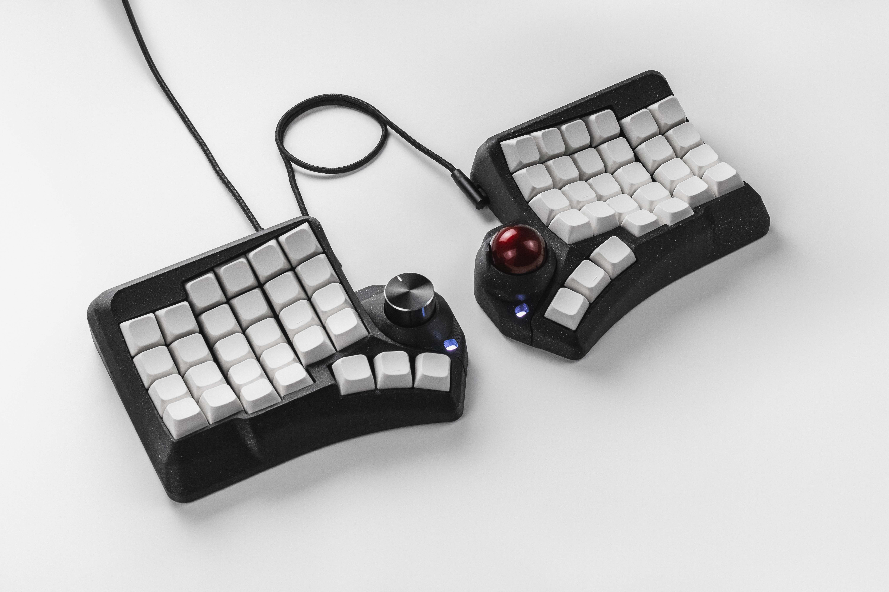
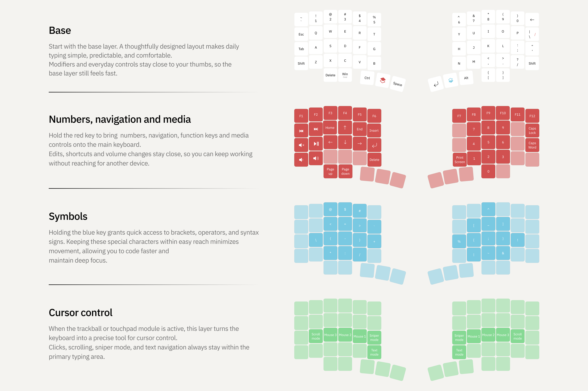
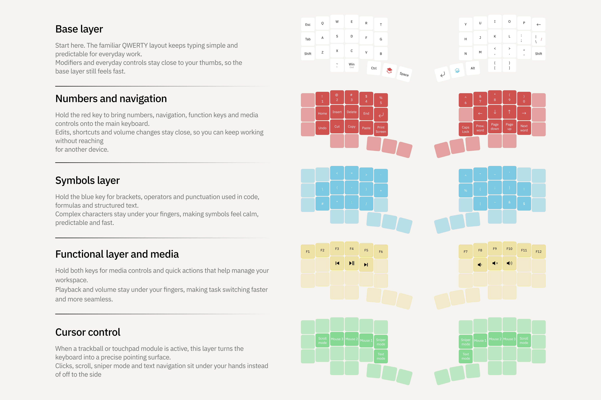
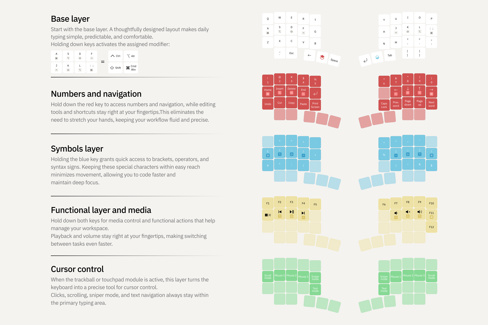

# Phenom — a flagship ergonomic split keyboard for those who value precision, speed, and complete control over their workspace

## Features

- Sculpted ergonomic 3D case with individually positioned rows and columns
- 58 programmable keys and up to 15 additional layers
- Hot-swappable MX switches
- Hot-swappable trackball, touchpad, and encoder modules for either half
- Scroll, Sniper, and Text modes for trackball and touchpad modules
- Key remapping and keyboard configuration through [Entropy](https://entropy.tools/)
- USB Type-C connectivity
- QMK firmware

Phenom Mini

46 programmable keys and up to 15 additional layers

Phenom Micro

40 programmable keys and up to 15 additional layers

## Files

Files for the PCB version of Phenom and its modules

- [`stl/`](stl/) — printable PCB-version models: [`body/`](stl/body/) and [`modules/`](stl/modules/)
- [`step/`](step/) — editable PCB-version STEP models: [`body/`](step/body/) and [`modules/`](step/modules/)
- [`pcb/`](pcb/) — Gerber archives, schematic PDFs, BOMs and pick-and-place files: [`switchplate/`](pcb/switchplate/), [`holder/`](pcb/holder/), [`pogo_system/`](pcb/pogo_system/) and [`modules/`](pcb/modules/)
- [`build_guide/`](build_guide/build_guide.en.md) — illustrated PCB assembly guide in English, including modules

## BOM

Quantities below are listed for the Phenom body, holder and each module

Each module table includes its pogo system base and module boards; do not add another shared pogo system BOM on top of these quantities

<strong>Phenom body</strong>

| Component | Quantity |
| --- | ---: |
| Switchplate + thumb keys PCBs | 1 pc |
| Diode 1N4148WT | 52 pcs |
| MX Hotswap sockets | 58 pcs |
| ZX-SH1.0-6PWT | 2 pcs |
| ZX-SH1.0-12PWT | 2 pcs |
| JST SH 1.0 Cable, 6-Pin, 100mm | 2 pcs |
| JST SH 1.0 Cable, 12-Pin, 100mm | 2 pcs |
| M2x4 Screw | 32 pcs |
| M3x5 Screw | 10 pcs |
| M3x5 Insert | 10 pcs |
| Bar Magnet 5x2x10mm | 18 pcs |
| Bumpons, 8x2 mm | 10 pcs |

<strong>Holder</strong>

| Component | Quantity |
| --- | ---: |
| MCU holder PCBs | 1 pc |
| Capacitor 1uF, 0402 | 4 pcs |
| Capacitor 15pF, 0402 | 4 pcs |
| Capacitor 100nF, 0402 | 10 pcs |
| Capacitor 2.2uF, 0402 | 2 pcs |
| ZX-SH1.0-12PWT | 2 pcs |
| ZX-SH1.0-6PWT | 2 pcs |
| ZX-SH1.0-14PWT | 2 pcs |
| Diode 1N4148WT | 10 pcs |
| Microcontroller RP2040 | 2 pcs |
| Resistor 5.1kΩ, 0402 | 6 pcs |
| Resistor 1kΩ, 0402 | 2 pcs |
| Resistor 200Ω, 0402 | 2 pcs |
| Resistor 27Ω, 0402 | 4 pcs |
| Push button GT-TC084E-H065-L5 | 4 pcs |
| LDO, SOT-23-3, 662K | 2 pcs |
| Flash memory W25Q32JVSSIQ | 2 pcs |
| USB-C connector USB-TYPE-C-018 | 4 pcs |
| 12 MHz crystal XXHCCLNANF-12.000000MHZ | 1 pc |

<strong>Encoder module</strong>

| Component | Quantity |
| --- | ---: |
| Pogo system module PCB | 1 pc |
| Pogo system base PCB | 1 pc |
| Encoder PCB | 1 pc |
| Led PCB | 1 pc |
| LED SK6812 mini-e | 1 pc |
| ZX-SH1.0-4PWT | 1 pc |
| ZX-SH1.0-4PWT | 1 pc |
| ZX-SH1.0-6PWT | 2 pc |
| ZX-SH1.0-14PWT | 1 pc |
| Pogo Pin Connector, 7mm | 8 pcs |
| EC11 Rotary Encoder | 1 pc |
| Diode 1N4148WT | 1 pc |
| Encoder Knob 26x17mm, Black | 1 pc |
| JST SH 1.0 Cable, 6-Pin, 60mm | 1 pc |
| JST SH 1.0 Cable, 4-Pin, 50mm | 1 pc |
| JST SH 1.0 Cable, 14-Pin, 60mm | 1 pc |
| Bar Magnet 5x2x10mm | 5 pcs |
| M2x4 Screw | 6 pcs |
| M2x4 Screw flat | 2 pcs |
| Bumpons, 8x2 mm | 3 pcs |

<strong>Touchpad module</strong>

| Component | Quantity |
| --- | ---: |
| Pogo system module PCB | 1 pc |
| Pogo system base PCB | 1 pc |
| Led PCB | 1 pc |
| LED SK6812 mini-e | 1 pc |
| ZX-SH1.0-4PWT | 1 pc |
| ZX-SH1.0-4PWT | 1 pc |
| ZX-SH1.0-14PWT | 1 pc |
| Pogo Pin Connector, 7mm | 6 pcs |
| Azoteq IQS43 Sensor | 1 pc |
| Acrylic Touchpad Plate | 1 pc |
| Connector PH2.0 4 pins, 2mm, 90 degree | 1 pc |
| Cable connector PH2.0 4 Pins, 60mm, one head | 1 pc |
| JST SH 1.0 Cable, 4-Pin, 50mm | 1 pc |
| JST SH 1.0 Cable, 14-Pin, 60mm | 1 pc |
| Bar Magnet 5x2x10mm | 5 pcs |
| M2x4 Screw | 2 pcs |
| M2x4 Screw flat | 2 pcs |
| Bumpons, 8x2 mm | 3 pcs |

<strong>Trackball module (32mm)</strong>

| Component | Quantity |
| --- | ---: |
| Pogo system module PCB | 1 pc |
| Pogo system base PCB | 1 pc |
| Trackball PCB | 1 pc |
| Led PCB | 1 pc |
| LED SK6812 mini-e | 1 pc |
| ZX-SH1.0-4PWT | 1 pc |
| ZX-SH1.0-4PWT | 1 pc |
| ZX-SH1.0-9PWT | 1 pc |
| ZX-SH1.0-14PWT | 1 pc |
| Pogo Pin Connector, 7mm | 8 pcs |
| Bearing Ball 3mm | 3 pcs |
| Trackball Ball 32mm, Dark Red | 1 pc |
| PMW3610 Sensor | 1 pc |
| Lens LM18-LSI | 1 pc |
| JST SH 1.0 Cable, 6-Pin, 60mm | 1 pc |
| JST SH 1.0 Cable, 4-Pin, 50mm | 1 pc |
| JST SH 1.0 Cable, 14-Pin, 60mm | 1 pc |
| Bar Magnet 5x2x10mm | 8 pcs |
| M2x4 Screw | 5 pcs |
| M2x4 Screw flat | 2 pcs |
| Bumpons, 8x2 mm | 3 pcs |

PCB manufacturing BOMs and pick-and-place files: [switchplate](pcb/switchplate/), [holder](pcb/holder/), [pogo system](pcb/pogo_system/), [encoder](pcb/modules/encoder/), [trackball](pcb/modules/trackball/) and [LED board](pcb/modules/)

## License

The files in this repository are licensed under a [Creative Commons Attribution-NonCommercial-ShareAlike 4.0 International License](https://creativecommons.org/licenses/by-nc-sa/4.0/)

See [LICENSE](LICENSE) for the full text

## Firmware

- [Pre-compiled files and update instructions](https://docs.eh.works/firmware/)
- [Source code](https://github.com/ergohaven/vial-qmk)

## Availability

The complete keyboard is available for purchase from [Ergohaven](https://eh.works/shop/tproduct/767494027-549625025652-phenom)
