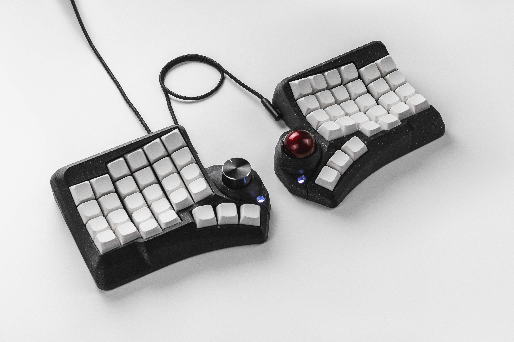
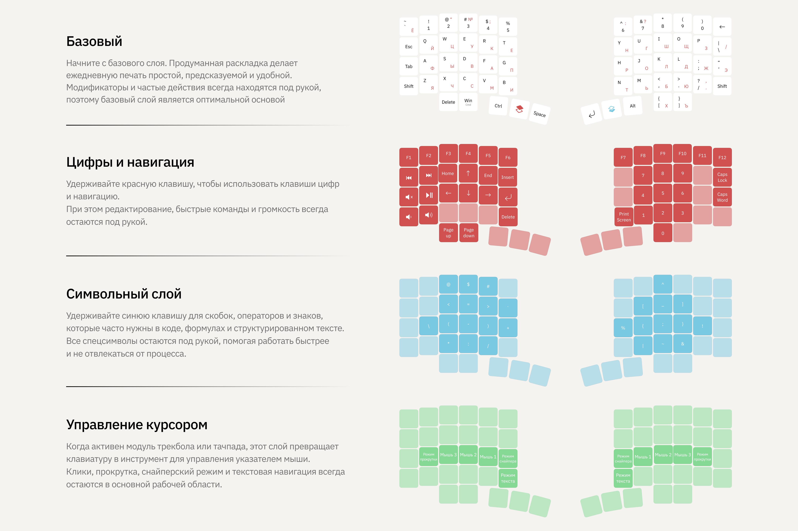
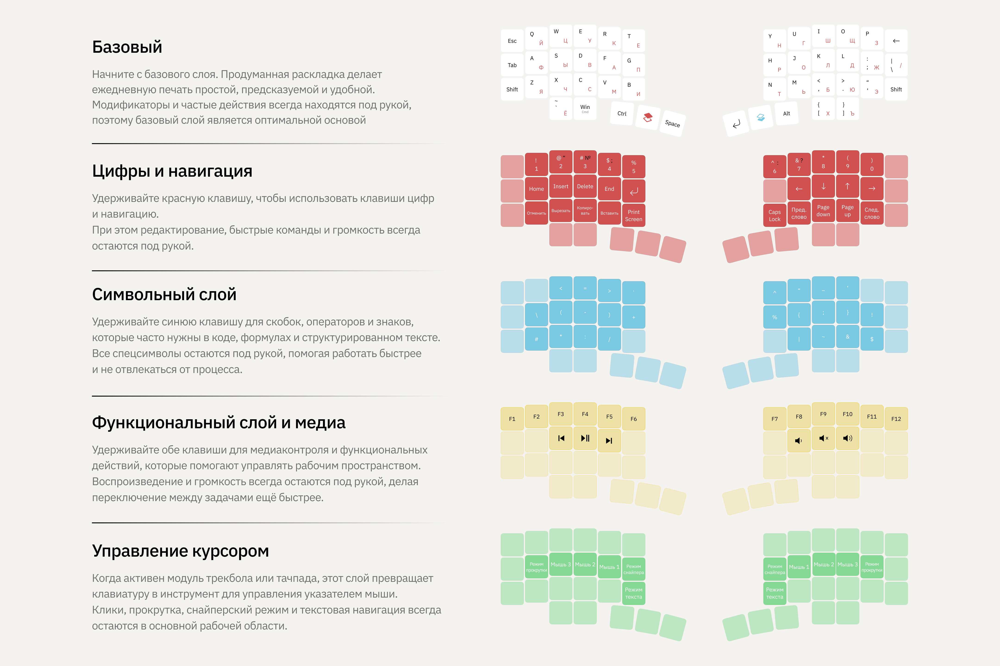
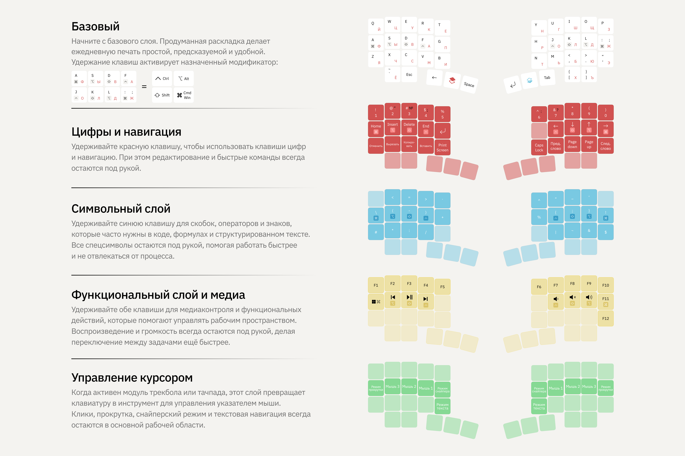

# Phenom

Phenom — флагманская эргономичная сплит-клавиатура для тех, кто ценит точность, скорость и полный контроль над рабочим пространством

[English](README.md)

## Features

- Изогнутый эргономичный 3D-корпус с индивидуальным расположением рядов и столбцов
- 58 настраиваемых клавиш и до 15 дополнительных слоёв
- Хотсвап MX-сокеты для замены переключателей без пайки
- Горячая замена модулей трекбола, тачпада и энкодера на любой половинке
- Режимы Scroll, Sniper и Text для трекбола и тачпада
- Переназначение клавиш и настройка клавиатуры через [Entropy](https://entropy.tools/ru/)
- Подключение через USB Type-C
- Прошивка QMK

Phenom Mini

46 настраиваемых клавиш и до 15 дополнительных слоёв

Phenom Micro

40 настраиваемых клавиш и до 15 дополнительных слоёв

## Files

Модели корпуса, файлы плат и инструкции по сборке будут добавляться по мере готовности

- `stl/` — модели корпуса и модулей для 3D-печати
- `step/` — редактируемые модели корпуса и модулей в формате STEP
- `pcb/` — Gerber-файлы, файлы сверловки, схемы и исходники плат
- `build_guide/` — инструкции по PCB-сборке на русском и английском, включая модули
- `handwired/` — инструкции по навесному монтажу на русском и английском, без модулей; отдельные модели в `stl/` и `step/` внутри раздела
- `images/` — фотографии и иллюстрации клавиатуры

## BOM

Свитчплейт и холдер: количества на две половинки. Для модулей и платы pogo_system ниже приведены количества из BOM соответствующей платы; дополнительные детали модулей указаны на один модуль

<strong>Свитчплейт — комплект на две половинки</strong>

| Компонент | Количество |
| --- | ---: |
| `ZX-SH1.0-12PWT` | 2 шт |
| Диод `1N4148WT` | 52 шт |
| Хотсвап-сокет Kailh `CPG151101S11-16` | 58 шт |
| `ZX-SH1.0-6PWT` | 2 шт |

[Исходный BOM (XLSX)](pcb/switchplate/BOM_Phenom_switchplate_v2_2.xlsx)

<strong>Холдер — комплект на две половинки</strong>

| Компонент | Количество |
| --- | ---: |
| Конденсатор 1uF, 0402 — `CC0402MRX5R6BB105` | 4 шт |
| Конденсатор 15pF, 0402 — `0402CG150J500NT` | 4 шт |
| Конденсатор 100nF, 0402 — `CL05B104KB54PNC` | 10 шт |
| Конденсатор 2.2uF, 0402 — `CL05A225MQ5NSNC` | 2 шт |
| `ZX-SH1.0-12PWT` | 2 шт |
| `ZX-SH1.0-6PWT` | 2 шт |
| `ZX-SH1.0-14PWT` | 2 шт |
| Диод `1N4148WT` | 10 шт |
| Микроконтроллер `RP2040` | 2 шт |
| Резистор 5.1kΩ, 0402 — `0402WGF5101TCE` | 6 шт |
| Резистор 1kΩ, 0402 — `0402WGF1001TCE` | 2 шт |
| Резистор 200Ω, 0402 — `0402WGF2000TCE` | 2 шт |
| Резистор 27Ω, 0402 — `0402WGF270JTCE` | 4 шт |
| Кнопка `GT-TC084E-H065-L5` | 4 шт |
| LDO, SOT-23-3, 662K | 2 шт |
| Flash-память `W25Q32JVSSIQ` | 2 шт |
| Разъём USB-C `USB-TYPE-C-018` | 4 шт |
| Кварцевый резонатор 12 МГц `XXHCCLNANF-12.000000MHZ` | 2 шт |

[Исходный BOM (XLSX)](pcb/holder/BOM_Phenom_holder_wired_v2.xlsx)

<strong>Общая плата подключения модулей — pogo_system</strong>

| Компонент | Количество |
| --- | ---: |
| `ZX-SH1.0-4PWT` | 1 шт |
| `ZX-SH1.0-9PWT` | 1 шт |
| `ZX-SH1.0-6PWT` | 1 шт |
| `ZX-SH1.0-14PWT` | 1 шт |

[Исходный BOM (XLSX)](pcb/pogo_system/BOM_Phenom_pogo_system.xlsx)

<strong>Модуль энкодера</strong>

| Компонент | Количество |
| --- | ---: |
| `ZX-SH1.0-8PWT` | 1 шт |
| Диод `1N4148WT` | 1 шт |
| Резистор 5.1kΩ, 0402 — `0402WGF5101TCE` | 1 шт |
| Резистор 10kΩ, 0402 — `RC0402FR-0710KL` | 1 шт |
| Энкодер EC11 | 1 шт |
| Колпачок энкодера | 1 шт |

[Исходный BOM (XLSX)](pcb/modules/encoder/BOM_Encoder.xlsx)

<strong>Модуль тачпада</strong>

| Компонент | Количество |
| --- | ---: |
| Тачпад Azoteq TPS43 | 1 шт |
| Разъём PH2.0, 4 контакта, шаг 2 мм, угловой 90° | 1 шт |
| Шлейф PH2.0, 4 контакта, 2 мм, 6 мм, с разъёмом на одном конце | 1 шт |

Использует общую плату pogo_system: разъём PH2.0 припаивается к плате, шлейф — к Azoteq TPS43

<strong>Модуль трекбола</strong>

| Компонент | Количество |
| --- | ---: |
| Конденсатор 100nF, 0402 — `CL05B104KB54PNC` | 4 шт |
| Конденсатор 10uF, 0402 — `CL05A106MQ5NUNC` | 2 шт |
| Конденсатор 10nF, 0402 — `TCC0402X7R103M500AT` | 2 шт |
| Конденсатор 3.3uF, 0402 — `C1005X5R0J335MTJ00E` | 1 шт |
| `ZX-SH1.0-6PWT` | 1 шт |
| Резистор 10kΩ, 0402 — `0402WGF1002TCE` | 1 шт |
| `AMS1117-1.8(SOT89-3)` | 1 шт |
| Сенсор `PWM3610` | 1 шт |
| Линза `LM18-LSI` | 1 шт |

[Исходный BOM (XLSX)](pcb/modules/trackball/BOM_Trackball_v1.xlsx)

Магниты, крепёж и остальные кабели будут добавлены после уточнения комплектации

## License

The files in this repository are licensed under a [Creative Commons Attribution-NonCommercial-ShareAlike 4.0 International License](https://creativecommons.org/licenses/by-nc-sa/4.0/)

Полный текст — в [LICENSE](LICENSE)

## Firmware

- [Готовые прошивки и инструкции по обновлению](https://docs.eh.works/firmware/)
- [Исходный код](https://github.com/ergohaven/vial-qmk)

Для handwired-версии на RP2040 Zero требуется отдельная адаптация назначения GPIO; совместимая прошивка пока не опубликована

## Availability

Готовую клавиатуру можно приобрести в [магазине Ergohaven](https://eh.works/shop/tproduct/767494027-549625025652-phenom)
